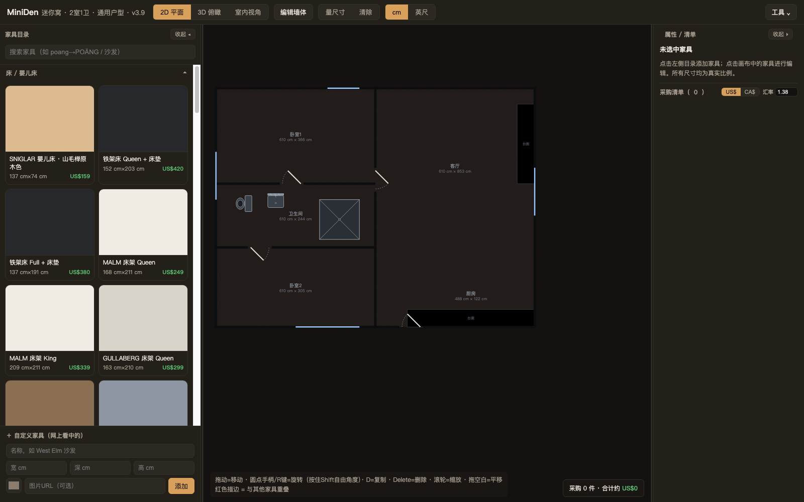
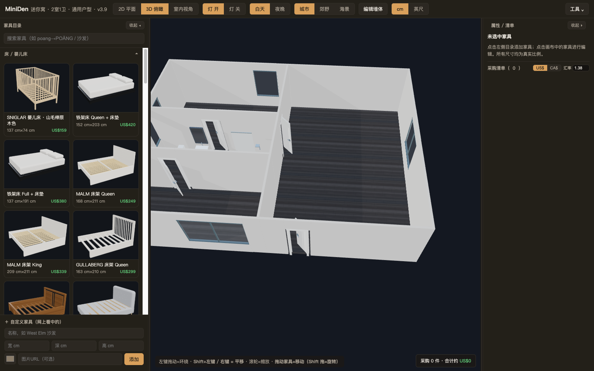

# MiniDen（迷你窝）

给一套高层公寓做家具规划的**单文件 Web 应用**。打开就能用：2D 平面图上拖放家具、
一键进 3D 娃娃屋 / 第一人称漫游、再一键出照片级渲染（浏览器里的软件路径追踪）。
不建模、不装软件——从「打开」到「形成我家的概念」以分钟计。





## 快速开始

没有构建步骤，没有网络依赖（`lib/` 全部本地化）：

```bash
git clone https://github.com/qining/miniden.git
open miniden/app.html          # macOS；或直接用 Chrome 打开 app.html
```

想要一个可托管 / 可分享的单文件产物：

```bash
cd miniden && npm install && npm run build
# → dist/app.html：three.js / dxf-parser / pdf.js 全部内联的独立单文件
```

## 它能做什么

- **2D 平面编辑器** — 拖放家具、画墙 / 异形柱 / 门（门洞与墙垛自动联动）、
  洁具放置工具、量尺寸工具、标准建筑图例
- **户型从哪来** — 三种：① 直接在编辑器里画；② 导入 **DXF**（图层名自动映射、
  单位自动检测、双线墙配对、一次确认）；③ 导入 **PDF 矢量图**（颜色语义、比例推断），
  扫描件可**描图**（底图 + 特征线辅助，沿底图描墙）
- **3D** — 娃娃屋俯瞰 + 室内第一人称（WASD 漫游）；275 件商品全部有专属 3D 模型
  （131 个模型函数，程序化木纹 / 织物 / 金属贴图，离线生成）
- **照片级渲染** — GPU 上的软件路径追踪：软阴影、间接光、À-Trous 降噪、
  分块自适应（弱显卡也能跑完）
- **采购清单** — 目录带美国 / 加拿大**当地实际标价**（不是汇率折算）、双币种切换、
  公寓自带灯具不计价
- **户型文档导出 / 导入** — 整份户型（几何 + 家具摆位）存成一个 JSON 文件，
  换浏览器 / 换机器都能带走
- **离线可用** — 运行时零 AI、零网络请求

## 快捷键

| 场景 | 键 |
|---|---|
| 选中家具 | `Delete` 删除 · `R` 转 15°（`Shift+R` 反向）· `[` `]` 微调 0.5°（`Shift` 0.1°）· `D` 复制 · 方向键移动（`Shift` 细步） |
| 墙体编辑 | 方向键微调 1cm（`Shift` 5cm）· `Enter` 完成画墙 / 多边形 · `Backspace` 撤一个顶点 / 删除选中 · `Esc` 取消 |
| 室内漫游 | `W` `A` `S` `D` / 方向键 |
| 量尺寸 | 再点按钮或 `Esc` 退出 |

URL hash 直达：`#3d`（娃娃屋）。

## 仓库结构

| 路径 | 是什么 |
|---|---|
| `app.html` | **唯一事实来源**（约 1 万行单文件应用，含 280 条家具目录） |
| `dist/app.html` | 构建产物：单文件公开入口（`npm run build` 生成） |
| `lib/` | vendored 运行时库（three.js r147 / OrbitControls / dxf-parser / pdf.js），署名见 [THIRD-PARTY.md](THIRD-PARTY.md) |
| `data/plans/generic.json` | 通用户型（2室1卫，无个人数据），内嵌进 `app.html` 的 `#miniden-plan` 块 |
| `src/` + `tests/` | schema / 导入管线 / **目录扩展协议**（`src/catalog/`）的 TypeScript 层 + vitest 单测 |
| `examples/packs/` | 目录包示例：把一批商品装进目录而不改 `app.html` 的可运行样本（见 [docs/design/catalog-extension.md](docs/design/catalog-extension.md)） |
| `bench/` | 浏览器交互测试台脚本（合成 PointerEvent 驱动真实 UI） |
| `scripts/` | 构建 / 测试门禁工具（见下） |
| `docs/` | 路线图、ADR、调研报告、设计总文档（[索引](docs/README.md)） |
| `.claude/skills/add-catalog-item/` | **给 AI agent 的「加家具入库」skill**（SKILL.md + `check-item.py` 体检 CLI）——这是本项目的交付物之一：家具目录的扩展方法本身是可执行的作业指导书 |

`private/`（gitignore）存放个人数据：真实户型 JSON、实拍照片、图纸扫描、UI 黄金基线。
公开仓库里的一切只含通用户型。

## 开发

```bash
npm run build              # app.html → dist/（单文件）+ 重新生成 bench 页面
npm test                   # vitest（schema / DXF / PDF / 图片描摹）
node scripts/run-bench.mjs # 浏览器交互测试台（t_walledit / t_3d / t_pt × source/dist）
npm run ui:gate            # UI 黄金截图门禁（8 个规范态，≤0.3%）
npm run e2e                # 真实输入 E2E（headful Chrome，人可看着跑）
npm run catalog:check      # 家具目录体检（内置 280 条；给一个包文件时坏条目即退出码 1）
```

### 完整演示：一条流程走完产品承诺

从空白户型 → 画出两室一厅一卫 → 门 / 洁具 / 固定灯具 → 摆家具 → 撤销 → 3D → 室内 →
光追 → 导出户型 JSON → 真实刷新后还在 → 删掉那份户型。每一步都有断言兜底，
每个阶段留一张截图。

```bash
npm run build                                        # 先重捆 dist（否则跑的是旧版）
node scripts/e2e.mjs --flow=demo-full                # 两个入口各 31 条（看着跑，约 100s / 入口）
node scripts/e2e.mjs --entry=planner --flow=demo-full --fast   # 只跑个人入口、不减速（约 36s）
```

产物：`work/e2e/report.html`（逐步截图 + 断言，人可审）、`log.json`、`shots/`（全 gitignore）。
`--ci` 口径不跑这条（它含一步真 GPU 光追，断言用的是未钉住取景的像素统计）。

共 26 条流程 / 196 断言（CI 口径 25 条 / 165 断言 × 2 入口）。此中九条走的是真实鼠标与真实键盘：
`--flow=counter-run`（沿实墙画台面 → 「选择/调整」里选中 → 改深度 → 放冰箱 → 删除）与
`--flow=undo-redo`（删洁具 → Ctrl+Z 找回来 → Ctrl+Y 重做 → **连放两个洁具 → 一次 Ctrl+Z 只撤最后那件** → 画墙 → Ctrl+Z → Ctrl+Y）与
`--flow=catalog-custom`（展开两个分类 → 切币种（会重建整个目录）后展开还在 → 搜索再清空 → 真实输入名字/宽/深造一件自定义家具 → 卡片真的看得见 → 宽留空时不许弹窗、只给一条非阻塞提示）与
`--flow=props-panel`（改颜色 → Ctrl+Z 只撤颜色而不把家具撤掉 → 真键盘在旋转框里打 720 → 框与滑块读同一个数 → 焦点还在数字框里按 Ctrl+Z 照样生效 → 宽填 99999 被拒且给一条看得见的提示）与
`--flow=measure-tool`（沿最长的一段墙真实量一次 → 滚轮放大 5 格后标注还是 1.600px / 10.00px 且落在可读区间 → 新建空白户型后旧标注作废 → 切回内置不复活 → 收尾删掉那份户型）与
`--flow=edit-in-3d`（真鼠标画一段墙 → 切 3D 俯瞰后那段墙立到顶 → 3D 画布上没有 2D 编辑工具条而「编辑墙体」还亮着 → 真键盘在 3D 里按方向键与 Delete 不改几何也不删墙 → 切回 2D 工具条原样回来且微调照常生效）。
`--flow=photo-freeze`（3D 俯瞰里点住家具手抖 2px 不挪 → 真拖动生效 → Ctrl+Z 一步退回 → 开光追后中途切视角/滚轮走动/Delete 全被拒并给出一条「先点取消」的提示 → 点取消真的提前停下（实测 9/900 次采样）→ 之后切视角照常）与
`--flow=multi-plan`（真点击选中刚画的墙 → 新建空白户型后工具条不再描述那段不存在的墙 → 按 Delete 不说「已删除」且墙数仍 0 → 切回内置户型时用户编辑还在 → 重命名 / 两步删除）与
`--flow=catalog-pack`（真实选择示例目录包 JSON → 确认弹窗说清包名/来源/条目数/建模代码数与「只加载你信任来源的包」→ 加载后目录真的多 3 条且新卡片看得见（不被折叠分组藏住）→ 真点击把它摆上图 → 真实刷新后包还在 → 两步移除 → 布局里那件仍在而面板如实写「目录里没有这件（仍在布局里）」价格「—」）。

### 扩展家具目录：不改代码也能加商品

家具目录的条目是数据、建模代码是函数源码，两者可以打包成一个 JSON 文件，在「工具 ⌄ → 导入目录包」里加载：
确认弹窗摊开包名 / 来源 / 条目数 / 建模代码数，并说明建模代码在你本机本地执行（这个应用不联网）。
内置目录永远赢（撞 id 的包条目被丢弃并如实报告）；包里的模型走同一套建模 API，也**不豁免**内置的三条硬约束
（占地填充率 92~102% / 所有部件贴地 / 重心归零）。移除包是两步确认，之后已摆放的家具不会消失，
但会显示成诚实的占位（「目录里没有这件（仍在布局里）」，价格「—」，仍可选可拖可删）。

```bash
npm run catalog:check                                        # 内置目录体检（280 条 / 146 模型 / 0 error 0 warning）
node scripts/catalog-check.mjs examples/packs/demo-side-tables.json   # 体检一个包文件
```

协议、上限表、建模代码契约、信任边界与还没做的部分：**[docs/design/catalog-extension.md](docs/design/catalog-extension.md)**。
给 AI agent 的逐件作业指导书：`.claude/skills/add-catalog-item/SKILL.md`。

CI（GitHub Actions）跑 generic 子集：vitest + build + bench + ui-gate + E2E + 包体预算。
接手这个项目请先读 **[AGENTS.md](AGENTS.md)**——它记录实测有效的流程、踩过的坑、
以及验证方法论（校准基线、隐私边界、测试台方法论）。

## 文档

- [docs/roadmap.md](docs/roadmap.md) — 工作顺序与状态（研究 R / 产品 S / 工程 E）
- [docs/decisions/](docs/decisions/) — ADR（0006「产品调性」是所有取舍的最高判据）
- [docs/research/](docs/research/) — 每个结论背后的调研（DXF 生态、渲染选型、UI 风格与验收……）
- [docs/design/](docs/design/) — 户型输入 → 3D 设计总文档

## 许可

[MIT](LICENSE)。第三方运行时库署名见 [THIRD-PARTY.md](THIRD-PARTY.md)。
